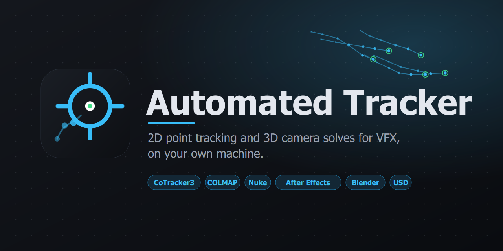
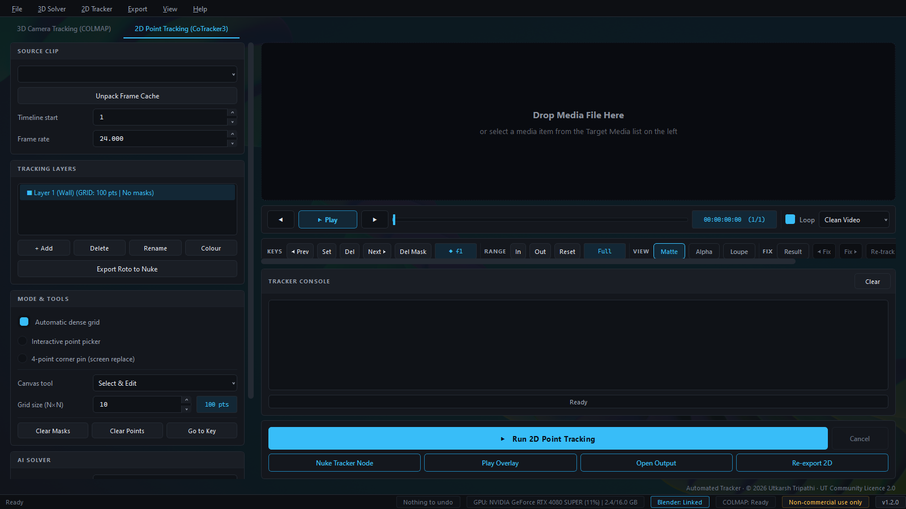
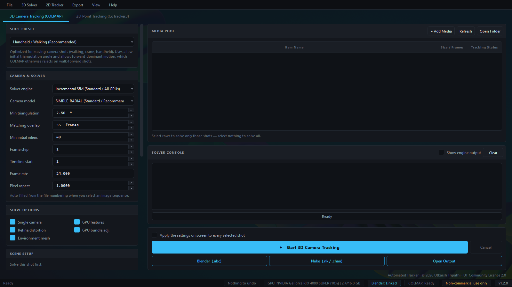
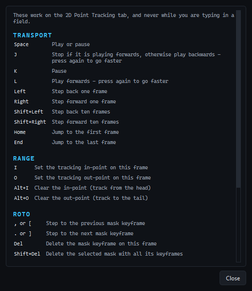

# Automated Tracker

2D point tracking and 3D camera solves for VFX shots, with exports for Nuke and Blender.

## Download

Get the latest setup from **[Releases](https://github.com/capsuleutkarsh-design/AutomatedTracker/releases/latest)**. Download every file of the release into one folder, then run the `.exe`.

Website and guide: https://capsuleutkarsh-design.github.io/automated-tracker/

## Screenshots

**2D tracking**

**3D camera solve**

**Keyboard shortcuts**

## Licence

Automated Tracker is free to use, made by Utkarsh Tripathi. It is not for sale. Please do not re-upload the setup or remove the author's name. The full licence is shown in the installer.

Questions and bug reports: [capsuleutkarsh@gmail.com](mailto:capsuleutkarsh@gmail.com)
